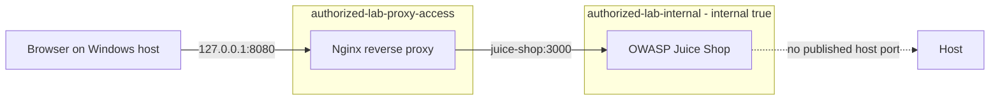

# Authorized Security Lab

A local, Docker-based cybersecurity learning environment and pre-assessment documentation project. It uses OWASP Juice Shop as an intentionally vulnerable training application behind an Nginx reverse proxy.

> **Safety and authorization:** This repository is for an isolated local lab. Starting the training application and running the configuration checks do not authorize penetration testing. Do not conduct security testing until the asset owner has confirmed ownership and scope, and the Rules of Engagement (ROE) have been completed and signed.

## Project goals

- Build a reproducible local training environment.
- Keep the intentionally vulnerable application off published host ports.
- Expose the application through an Nginx proxy bound only to loopback.
- Separate the application from the proxy's host-published access network.
- Document assets, architecture, data flows, STRIDE threats, abuse cases, controls, evidence handling and authorization requirements.
- Provide PowerShell checks for configuration and runtime posture.

## Architecture



- **Juice Shop** listens on container port 3000 and is attached only to `authorized-lab-internal` (`internal: true`). It has no published host port.
- **Nginx** listens on container port 8080 and is attached to both Docker networks.
- Docker publishes Nginx as `127.0.0.1:8080:8080`; it is not intentionally exposed on a LAN interface.
- `authorized-lab-proxy-access` is a standard bridge network, not an internal network. Nginx is attached to it to support the host-published endpoint. Do not attach Juice Shop to this network.
- Docker network isolation is not a substitute for reviewing host firewall, Docker Desktop and endpoint-security settings.

## Repository layout

| Path | Purpose |
|---|---|
| `docker-compose.yml` | Two-container lab architecture and hardening settings |
| `config/nginx.conf` | Reverse-proxy configuration |
| `scripts/preflight.ps1` | Static Compose and architecture checks |
| `scripts/verify-lab.ps1` | Runtime network, port, hardening and HTTP checks |
| `inventory/` | Asset inventory |
| `lab/` | Local deployment and safety instructions |
| `docs/` | Architecture, STRIDE, abuse cases, controls, ROE and evidence documentation |
| `evidence/` | Evidence register and local evidence folders; do not commit sensitive evidence |

## Requirements

- Windows 10/11 with Docker Desktop and Docker Compose v2 or compatible.
- PowerShell 5.1 or later.
- Docker Desktop started manually when you want to use the lab.
- Git (optional, for cloning and updating this repository).

The Compose file pins Juice Shop to `v20.3.0`; Nginx uses the Alpine tag. For stronger image reproducibility, consider pinning Nginx to a reviewed version or digest after validating the image you intend to use.

## Quick start (PowerShell)

Clone the repository and enter its directory:

```powershell
git clone https://github.com/sunnykumard/authorized-security-lab.git
cd authorized-security-lab
```

Start Docker Desktop manually, then validate the Compose configuration:

```powershell
.\scripts\preflight.ps1
```

Start the local training application:

```powershell
docker compose up -d
docker compose ps
docker compose logs --tail 50 juice-shop
docker compose logs --tail 50 lab-proxy
```

Verify the local configuration:

```powershell
.\scripts\verify-lab.ps1
```

Open:

`http://127.0.0.1:8080`

The verification script checks Docker runtime settings, network membership, port publication, loopback binding and the local HTTP response. It does not test application vulnerabilities.

## Stop the lab

When finished:

```powershell
docker compose down
```

Then quit Docker Desktop if you do not want it running. The Compose services use `restart: "no"`; they are not configured to restart automatically after a Docker daemon restart.

Do not use `docker compose down -v` unless you have reviewed the volumes and intentionally want to remove them.

## Security design notes

- Juice Shop has no host-published port.
- Juice Shop is connected only to the internal Docker network.
- Nginx is the only service connected to both networks.
- The Nginx host port is bound to `127.0.0.1`.
- Both containers drop all capabilities by default; Nginx adds only `CHOWN`, `SETGID` and `SETUID` because its startup and worker privilege handling require them in this read-only container setup.
- Both containers use `no-new-privileges` and resource limits.
- Nginx uses a read-only root filesystem with temporary writable `tmpfs` paths.
- The lab contains an intentionally vulnerable application. Never expose it through `0.0.0.0`, a public tunnel, a LAN-facing port or an unapproved network.

## Scope and authorization

Current local Docker scope:

| Asset ID | Asset | Endpoint | State |
|---|---|---|---|
| LAB-01 | OWASP Juice Shop | Internal container port 3000; accessed via proxy | Deployed locally |
| LAB-02 | Nginx reverse proxy | `127.0.0.1:8080` | Deployed locally |
| NET-01 | Internal Docker network | `authorized-lab-internal` | Configured |
| NET-02 | Proxy access bridge | `authorized-lab-proxy-access` | Configured |
| VM-01 | Separate training VM | Proposed `192.168.56.20` | Not deployed or validated |

VM-01 is **not part of the active lab**. Do not boot or test it until its image provenance, host-only network, address, snapshot and written scope approval are independently confirmed.

Security testing remains **NOT AUTHORIZED** while the ROE and authorization fields are pending. Do not treat a local lab deployment as permission to test any system.

## Documentation

- [Asset inventory](inventory/authorized-lab-assets.csv)
- [Architecture and data flow](docs/architecture-data-flow.md)
- [STRIDE threat register](docs/stride-threat-register.md)
- [Abuse-case analysis](docs/abuse-case-analysis.md)
- [Security controls mapping](docs/security-controls-mapping.md)
- [Rules of Engagement](docs/rules-of-engagement.md)
- [Evidence handling plan](docs/evidence-handling.md)
- [Authorization and readiness status](docs/authorization-status.md)
- [Local lab setup](lab/README.md)

## Limitations

- The scripts are configuration and availability checks, not a penetration-testing framework.
- The scripts validate LAB-01 and the Docker topology; they do not validate VM-01.
- A successful HTTP response does not demonstrate that the application is secure.
- Docker network inspection does not independently prove host firewall or endpoint-security behaviour.
- Application-level authentication, authorization, input validation and logging controls remain unverified until assessed under an approved scope.

## License

No license is currently declared. Unless a license is added, the repository's contents are not granted an open-source reuse license by this README. The OWASP Juice Shop image and Nginx image remain subject to their respective upstream licenses and terms.
