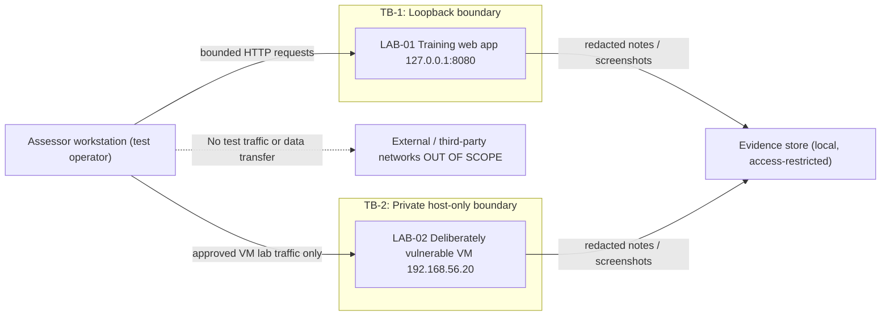

# Lab Architecture, Assets, Trust Boundaries, and Data Flow

## 1. Architecture overview

The engagement uses only two explicitly inventoried targets. This document describes the expected design; verify the actual deployment before testing. Any discovered service or dependency not listed in the asset inventory is not automatically authorized.

- **LAB-01 — Local training web app:** `http://127.0.0.1:8080`, accessible only from the assessor's local machine.
- **LAB-02 — Deliberately vulnerable VM:** `192.168.56.20`, accessible only over a private host-only virtual network.
- **Assessor workstation:** administrative/test client, not an independently approved target. It may be used only to operate the lab and generate bounded test requests. Do not perform security tests against the workstation, host OS, hypervisor, or other local services.
- **Lab owner:** RabTech lab, per supplied inventory. Named individual and escalation contact must be filled in before test authorization.

## 2. Trust boundaries

| Boundary | Description | Security requirement |
|---|---|---|
| TB-1: Assessor workstation to localhost app | Loopback interface to LAB-01 | Bind app to loopback; restrict requests to the local host; do not expose it on LAN interfaces |
| TB-2: Assessor workstation to host-only VM | Private virtual network to LAB-02 | Host-only adapter only; no bridged mode, port forwarding, or route to public/third-party systems |
| TB-3: Application to its local data store (if present) | Internal app process boundary | Treat database/storage as part of LAB-01 only if owner documents and approves it; otherwise do not probe separately |
| TB-4: Lab to external networks | Any internet, campus, home, office, or cloud route | Prohibited for test traffic; disable outbound access and stop if observed |

## 3. Data classes

| Class | Examples | Handling |
|---|---|---|
| D0 — Synthetic/public training data | Seeded demo records, deliberately fake content | May be used for tests; keep within lab |
| D1 — Lab configuration | Service settings, version information, network configuration | Minimum collection; redact sensitive values in reports |
| D2 — Credentials/secrets | Test passwords, session tokens, keys | Use disposable synthetic credentials only; never reuse real credentials; redact immediately |
| D3 — Personal/production/confidential data | Real identities, real user records, production data | Not authorized; stop immediately if encountered; do not copy or inspect |

## 4. Identities and roles

| Identity | Purpose | Privilege rule |
|---|---|---|
| Lab owner (RabTech lab; named contact pending) | Owns assets and grants written authorization | Approves scope, window, allowed techniques, emergency contact, and stop/restart |
| Assessor (name to be completed) | Performs approved checks | Uses named, least-privilege lab accounts; no credential reuse |
| Synthetic application user | Exercises normal application behavior | Disposable account with minimum required role |
| Synthetic administrator (only if supplied/approved) | Validates administrative authorization controls | Use only within the app/VM and only for explicitly approved checks |
| VM local administrator | Manages the training VM | Administrative access for setup/rollback only; do not test the hypervisor/host |

Do not create, test, or use an identity that the owner has not supplied or explicitly approved. Do not attempt privilege escalation beyond the agreed application/VM test cases.

## 5. Data-flow diagram

The following Mermaid diagram is the intended logical flow. It does not imply that an unlisted database, service, or network endpoint is in scope.

## 6. Expected attack surfaces (confirm before testing)

- LAB-01: HTTP routes and methods exposed by the local training web application; authentication/session handling; input validation; authorization checks; security headers and error handling.
- LAB-02: only services deliberately enabled for the exercise and documented by the lab owner; local authentication and configuration; host firewall and network exposure as observed from the host-only segment.
- Management interfaces, hypervisor services, host-operating-system services, shared folders, clipboard integration, bridged/NAT adapters, and unrelated services are not targets.

## 7. Pre-test validation checklist

- [ ] Both targets match the exact inventory addresses.
- [ ] LAB-01 listens only on loopback (not 0.0.0.0 or a LAN address).
- [ ] LAB-02 network adapter is host-only; bridged networking, NAT, port forwarding, and external routes are disabled.
- [ ] No route from the lab to public, campus, home, office, or third-party networks.
- [ ] Synthetic data and disposable accounts are used.
- [ ] VM snapshot and app/database backup are available.
- [ ] Owner has confirmed the named contacts, test window, allowed techniques, and emergency stop process.
- [ ] Any newly discovered asset is excluded until written inventory amendment and approval.
