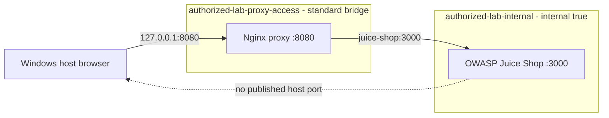

# Architecture and Data-Flow Documentation

## 1. Project Overview

Project: Authorized Security Lab  
Environment: Local Docker-based training environment  
Application: OWASP Juice Shop v20.3.0  
Reverse Proxy: Nginx  
Host Operating System: Windows with Docker Desktop  
Access URL: http://127.0.0.1:8080

This document describes the deployed local topology. It is not authorization to conduct security testing.

## 2. Architecture Components

| Component | Identifier | Purpose |
|---|---|---|
| Windows Host | Local machine | Runs Docker Desktop and the browser |
| Nginx Proxy | authorized-lab-proxy | Provides localhost-only application access |
| Juice Shop | authorized-lab-juice-shop | Intentionally vulnerable training application |
| Internal Network | authorized-lab-internal | Internal application network |
| Proxy Access Network | authorized-lab-proxy-access | Standard bridge network used by Nginx for the published endpoint |

## 3. Architecture Diagram

## 4. Network Configuration

### Internal Application Network

- Name: authorized-lab-internal
- Driver: bridge
- Internal: true
- Connected containers:
  - authorized-lab-juice-shop
  - authorized-lab-proxy

Docker may assign different subnets and container IP addresses after recreation. Use service DNS name `juice-shop` rather than relying on a fixed container IP.

### Proxy Access Network

- Name: authorized-lab-proxy-access
- Driver: bridge
- Internal: false (standard bridge)
- Connected containers:
  - authorized-lab-proxy only

This network is not an internal Docker network. Nginx is attached to it to support the host-published port. The host port is explicitly bound to loopback. Do not attach Juice Shop to this network.

## 5. Data Flow

1. The user opens `http://127.0.0.1:8080` on the Windows host.
2. Docker forwards the loopback-published port to Nginx container port 8080.
3. Nginx resolves the Compose service name `juice-shop` on the internal Docker network.
4. Nginx forwards the request to `http://juice-shop:3000`.
5. Juice Shop processes the request.
6. The response returns through Nginx to the user's browser.

## 6. Security Boundaries

- Juice Shop has no published host port.
- Juice Shop is connected only to the internal Docker network.
- Nginx is the only container connected to both Docker networks.
- The Nginx host-published port is bound to 127.0.0.1.
- The proxy access network is a standard bridge, not an internal network.
- Docker network isolation does not independently prove host firewall or endpoint-security isolation.
- No external or third-party targets are included in the proposed lab scope.

## 7. Observed Local Validation

User-provided PowerShell output on 2026-11-15 recorded:

- Juice Shop container: Running at the time of validation.
- Nginx container: Running at the time of validation.
- Juice Shop port 3000: `{"3000/tcp":null}` (no host binding).
- Nginx port 8080: `127.0.0.1:8080`.
- HTTP response from `http://127.0.0.1:8080`: HTTP 200 OK.
- Internal Docker network: `Internal: true`.
- Proxy access network: `Internal: false`.
- Juice Shop membership in proxy access network: Not present.

Container running state is temporary and must be checked again when the lab is started.

## 8. Limitations

- Docker network isolation does not independently prove host firewall isolation.
- Container IP addresses may change after recreation.
- The separate VM proposed at 192.168.56.20 has not been deployed or validated.
- Application-level security controls have not been assessed by this configuration review.
- This document records lab configuration, not authorization to conduct security testing.

## 9. Authorization Status

Security testing remains NOT AUTHORIZED until asset ownership and scope are confirmed, written authorization is obtained, and the Rules of Engagement are completed and signed.
